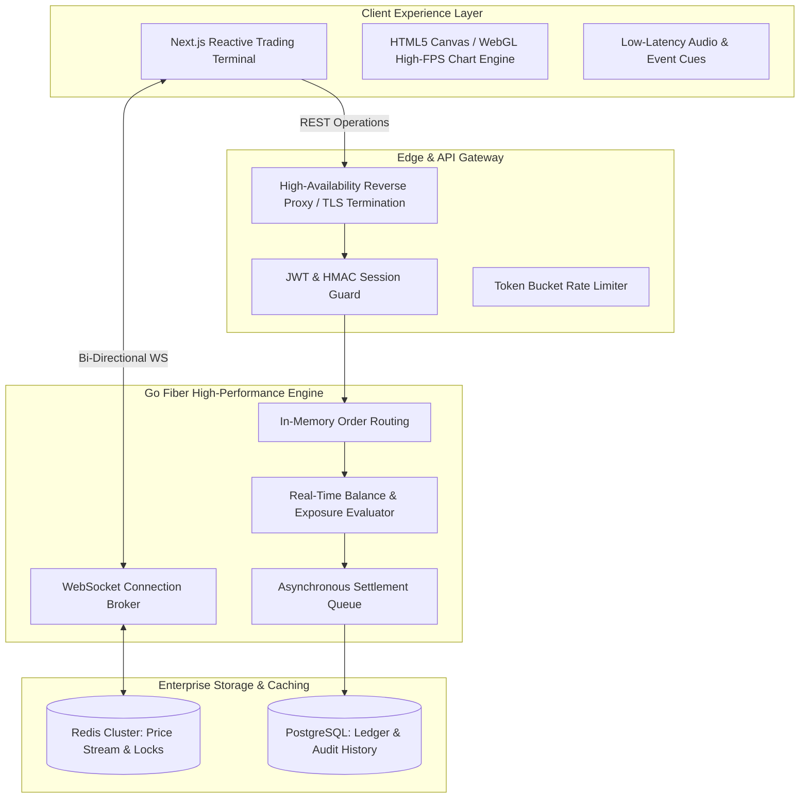

# ApexTrade — High-Frequency Binary & Forex Trading Platform

An institutional-grade trading platform architecture designed for multi-asset binary options and forex execution. Features real-time price streaming via binary WebSockets, sub-millisecond execution pipelines, deterministic risk controls, and a reactive trading terminal interface.

## Key Architectural Highlights

1. **Sub-Millisecond Order Routing**: In-memory balance pre-reservation and atomic state updates preventing race conditions.
2. **Binary WebSocket Streaming**: Delta-compressed tick feeds providing smooth 60fps candlestick rendering with minimal network overhead.
3. **Institutional Risk Management**: Per-user and platform-wide exposure caps, automated drawdown mitigation, and suspicious activity circuit-breakers.
4. **Hydration-Safe Trading Interface**: Next.js App Router frontend engineered for zero layout shift and deterministic server/client state reconciliation.

---

## 💼 Enterprise Client Demonstration & Inquiries

> **Proprietary Notice & Client Confidentiality**:  
> This public repository contains enterprise architectural blueprints, interface definitions, and design patterns. To protect institutional client confidentiality and proprietary intellectual property, production business algorithms, private contracts, and live infrastructure credentials are intentionally excluded.

### 📅 Schedule a Technical Deep-Dive
If you are an enterprise client or institutional partner evaluating our capabilities:
- **Live Platform Demos**: Available during a scheduled technical walkthrough.
- **Production Code Audits**: Comprehensive code inspection available under mutual Non-Disclosure Agreement (NDA).
- **Custom Implementations**: Full turnkey deployment, white-label customization, and bespoke engineering.

📬 **Contact for Business & Technical Inquiries:**  
- **Email**: devopsjahidulislam@gmail.com / admin@starit.farm  
- **GitHub**: [@staritfarm](https://github.com/staritfarm)  
